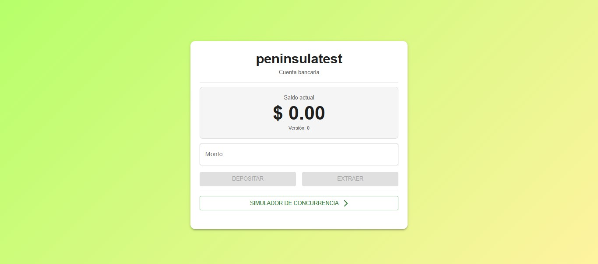

# Peninsula - Desafío Técnico Fullstack

## Descripción

Este proyecto es una aplicación de gestión de cuentas de prueba que permite realizar depósitos, extracciones y simular concurrencia de operaciones sobre el saldo. La solución incluye backend en Node.js/Express y frontend en React/TypeScript, con el objetivo de demostrar la correcta gestión de concurrencia y la integración end-to-end entre cliente y servidor.

El proyecto se desarrolló como parte del desafío técnico para evaluar habilidades en desarrollo Fullstack, manejo de datos concurrentes y buenas prácticas de programación.

## Estructura del Proyecto

**Peninsula-TechnicalTest-Fullstack/**
 - **backend/**: Lógica del servidor, API REST y manejo de concurrencia. Contiene su propio README con instalación, estructura de carpetas, modelo de datos, pruebas de concurrencia y capturas.
 - **frontend/**: Interfaz de usuario, simulación de operaciones y visualización de saldo. Contiene su propio README con descripción de componentes, hooks, rutas, servicios, tema visual y capturas del flujo completo.
 - **README.md**: Descripción generica del proyecto

## Tecnologías Principales

- **Backend**: Node.js, Express, MongoDB, Mongoose, TypeScript
- **Frontend**: React, TypeScript, React Router, Material UI, Vite

La elección de tecnologías se basó en el perfil MERN/PERN, facilidad de integración y mi experiencia práctica para implementar correctamente la simulación de concurrencia y la interacción con la API.

## Funcionalidades principales

- Mostrar el saldo actual de la cuenta de prueba.
- Realizar depósitos y extracciones.
- Simular concurrencia de múltiples operaciones.
- Visualización de errores y respuestas del backend en tiempo real.

## Instalación y ejecución

Para levantar el proyecto localmente:

1) Clonar el repositorio.
2) Seguir las instrucciones de instalación y ejecución en los READMEs específicos:
    - [Backend](./backend/README.md)
    - [Frontend](./frontend/README.md)

**Nota**: El frontend depende de que el backend esté ejecutándose, ya que consume su API para mostrar datos de la cuenta y ejecutar operaciones.

## Captura representativa

Se incluye una captura del inicio de la aplicación para referencia rápida. El resto del flujo completo, incluyendo depósitos, extracciones y simulación de concurrencia, está disponible en el README del frontend junto con todas las imágenes.

## Notas adicionales

- Cada sección del proyecto tiene su README independiente, que detalla estructura de carpetas, archivos relevantes y decisiones de diseño.
- No se incluye un ejecutable pero para facilitar la visualización del proyecto, se incluyen capturas representativas del flujo de uso en el README del frontend.

## Autora

Tatiana Delsoglio - Full Stack Developer