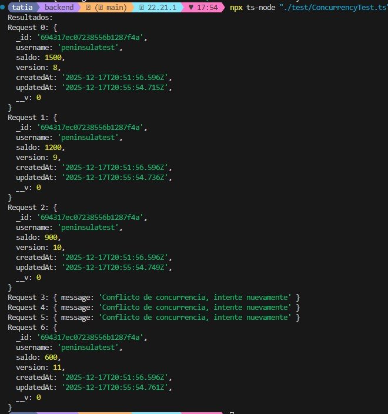
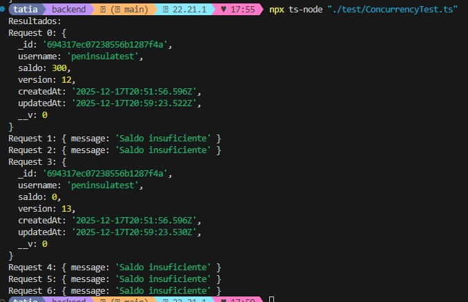

## Backend

Desde el backend resuelvo la gestión de cuentas y operaciones de depósito y extracción de saldo.
La solución fue diseñada para responder el problema central planteado en el desafío técnico: **garantizar la integridad del saldo de una cuenta frente a múltiples solicitudes simultáneas**, evitando condiciones de carrera y estados inválidos.
Para ello, implemente una estrategia de control de concurrencia mediante optimistic locking, priorizando simplicidad, claridad y rendimiento.

--

## Alcance

Para el alcance de esta prueba técnica, el sistema **asume autenticación previa**.
El mecanismo de login y gestión de usuarios no forma parte del problema central a resolver y fue intencionalmente excluido para mantener el foco en la lógica de concurrencia sobre saldos.
Con el objetivo de facilitar la ejecución y evaluación del proyecto, se inicializa automáticamente una cuenta de prueba al levantar el backend.

--

## Cuenta de Prueba

Al iniciar la aplicación, el backend garantiza la existencia de una cuenta de prueba:
- Username: peninsulaTest
- Saldo inicial: 0
- Versión inicial: 0

Si la cuenta no existe, se crea automáticamente. si ya existe, se reutiliza.
Esto permite ejecutar pruebas y consumir la API desde el inicio.

--

## Tecnologías

Las tecnologías que utilicé fueron seleccionadas considerando el perfil del puesto Full Stack MERN / PERN, el contexto actual del ecosistema JavaScript y la adecuación de cada herramienta al problema a resolver.

Asimismo, prioricé tecnologías con las que cuento experiencia práctica y que resultan apropiadas para implementar y demostrar correctamente la lógica de concurrencia requerida en el desafío.

- Node.js + Express: Los elegí para construir una API REST liviana y eficiente, adecuada para manejar múltiples solicitudes concurrentes.

- TypeScript: Lo elegí por ser el lenguaje solicitado en el desafío técnico y por los beneficios que aporta en términos de tipado estático, robustez y mantenibilidad.

- MongoDB + Mongoose: MongoDB se utiliza como base de datos documental, y Mongoose como ODM para modelar el dominio y facilitar operaciones atómicas y controladas sobre los documentos.

--

## Modelo de datos

Utilicé una colección `accounts` para representar las cuentas del sistema.

Cada cuenta contiene:
- `username`: identificador lógico de la cuenta.
- `saldo`: saldo actual de la cuenta.
- `version`: número de versión utilizado para control de concurrencia.
- `createdAt` / `updatedAt`: marcas de tiempo automáticas.

El campo `version` me permite detectar modificaciones concurrentes sobre el mismo documento y es clave para la estrategia de optimistic locking.

--

## Estrategia de consistencia

La consistencia de los datos se garantiza mediante **optimistic locking** utilizando un campo de versión.

En cada operación de actualización valida que la versión del documento no haya cambiado desde su lectura inicial.  
Si la versión no coincide, la operación falla por conflicto de concurrencia.
Este enfoque permite manejar concurrencia sin bloqueos pesados, manteniendo un buen rendimiento.

--

## Manejo de errores

El sistema diferencia entre errores de negocio y errores de concurrencia:

- **Saldo insuficiente**: cuando una operación de extracción supera el saldo disponible.
- **Conflicto de concurrencia**: cuando múltiples solicitudes intentan modificar la misma cuenta simultáneamente y se agotan los reintentos.

Los errores se comunican de forma clara al cliente mediante mensajes descriptivos.

--

## Reintentos y resiliencia

Ante conflictos de concurrencia, el sistema reintenta la operación hasta un máximo configurable (`MAX_RETRIES`).

Esto permite que muchas operaciones concurrentes válidas se resuelvan automáticamente, reduciendo fallos innecesarios sin comprometer la consistencia.

--

## Pruebas de concurrencia

La concurrencia la validé mediante un script que dispara múltiples solicitudes HTTP simultáneas utilizando `Promise.all`.

El script simula accesos concurrentes reales sobre la misma cuenta, permitiendo observar:
- operaciones exitosas,
- conflictos de concurrencia,
- y validaciones de saldo insuficiente.

El estado final de la cuenta se mantiene siempre consistente, sin saldos negativos.

## Capturas de pruebas de concurrencias ejecutada mediante el script `ConcurrencyTest.ts`.

### Intento 1 - Estado inicial

- Saldo inicial (Se deposito): 1800
- Cada request intenta retirar: 300
- Total de requests: 7
- Retiro total teórico: 2100 (lo cual no es posible)

En este caso en particular 4 operaciones se aplicaron correctamente, 3 fallaron por conflicto de versión. El sistema evitó que múltiples updates usaran la misma versión. Quedo un saldo final coherente de 600.

#### Intento 2 - segundo teste post intento 1

- Saldo restante: 600
- Cada request sigue intentando retirar: 300
- En este caso, el máximo de extracciones posibles son 2.

El resultado fue que dos request llegaron cuando todavía habia saldo suficiente, el resto fallo por regla de negocio, no por concurrencia. No hubo conflicto porque ya no habia saldo.

--

## Estrategia para evitar deuda técnica

- Separé responsabilidades mediante controladores, servicios y modelos, evitando mezclar lógica de negocio con manejo HTTP.

- La lógica crítica se centraliza en la capa de servicios, facilitando mantenimiento, pruebas y futuras extensiones del sistema.

- Cree una API mínima, alineada estrictamente al alcance del desafío.

- Evité sobre-ingeniería innecesaria para mantener claridad y simplicidad en un desafío acotado.

--

## Ejecución

1. Estar posicionado en la carpeta backend.
2. Instalar dependencias: **npm install**
3. Iniciar el servidor: **npm run dev**

Extra:
Para la ejecucion de scrip de concurrencia por consola: **npx ts-node "./test/ConcurrencyTest.ts"** 

--
