## Frontend

Para el frontend desarrollé una **vista de cuenta bancaria** que se conecta con la cuenta de prueba creada por el backend. El objetivo principal es **permitir la gestión de depósitos y extracciones**, así como **simular concurrencia**, siguiendo estrictamente el foco del desafío técnico: garantizar la integridad del saldo frente a múltiples operaciones simultáneas.

--

## Alcance

La vista se levanta automáticamente utilizando la cuenta de prueba, por lo que no implementé login ni creación de usuarios, ya que quería mantenerme alineada con lo que pedía el enunciado. Me enfoqué en crear una interfaz agradable e intuitiva, donde cada acción refleja en tiempo real la respuesta del backend. Además, incorporé una sección para simular concurrencia, permitiendo tanto valores predeterminados como personalizados, de manera que cualquiera pueda probar distintos escenarios de forma libre y cómoda. 
Con esta solución, busqué cumplir con el objetivo del desafío, extendiéndome un poco más para mostrar también cómo manejo el diseño y el flujo completo de la aplicación de manera consistente.

--

## Tecnologías

Para el frontend seleccioné tecnologías que me permitieran construir una interfaz moderna, intuitiva y mantenible, alineada con el perfil Fullstack MERN/PERN y con el objetivo del desafío técnico. También prioricé herramientas con las que tengo experiencia práctica, para poder implementar correctamente la conexión con el backend y la simulación de concurrencia.

- React: Lo elegí por su eficiencia para construir interfaces reactivas y componentes reutilizables. Me permite gestionar estados y actualizar la UI de forma instantánea ante cambios en los datos.

- TypeScript: Principalmente lo usé porque lo pide el enunciado. Asi mismo tambien me parece perfecto para este desafío técnico porque aportar tipado estático y mayor robustez al código, evitando errores que podrían aparecer al ejecutar la app y facilitando entenderlo y mantenerlo.

- React Router: Lo incorporé para poder moverme entre las distintas vistas de manera simple, sin complicaciones, y dejando el proyecto preparado para agregar nuevas pantallas si fuera necesario.

- MUI (Material UI): Lo elegí para armar los componentes visuales rápido, que se vean consistentes y agradables, sin tener que diseñar todo desde cero.

- @emotion/react / @emotion/styled: Los usé para darle estilo a los componentes de forma flexible, pudiendo combinar diseño y funcionalidad de manera clara y sencilla.

- Vite: Lo seleccioné porque hace que levantar el proyecto y construirlo sea rápido y simple, sin perder tiempo en configuraciones complicadas.

Con esta combinación de tecnologías pude desarrollar un frontend funcional, estético y alineado con el objetivo del desafío, mostrando también una experiencia end to end al integrarlo con el backend y la simulación de concurrencia.

--

## Estructura del Frontend

El frontend está organizado para que sea fácil de entender, mantener y expandir, siguiendo un flujo claro desde la carga de la aplicación hasta la interacción con el backend. A continuación describo cómo está estructurado y el propósito de cada sección:

- **src/components/account/**: En esta carpeta agrupé todos los componentes relacionados con la gestión de la cuenta bancaria, desde la visualización del saldo hasta las acciones y la simulación de concurrencia.
  - **AccountActions.tsx**:Contiene los botones y el campo de monto para realizar depósitos y extracciones. Maneja la validación básica del monto y limpia el campo después de cada operación.
  - **ConcurrencySimulator.tsx**: Permite simular múltiples operaciones concurrentes sobre la cuenta, mostrando los resultados de cada request en tiempo real. Esto ayuda a probar cómo responde el backend ante situaciones de concurrencia.
  - **SaldoCard.tsx**: Muestra el saldo actual de la cuenta y su versión. Si la información aún se está cargando, muestra un indicador de carga para que el usuario sepa que la operación está en proceso.

- **src/components/layout/MainLayout.tsx**: Este componente define la estructura general de la app. Se encarga de centrar el contenido en la pantalla y aplicar un fondo agradable, sirviendo como contenedor para todas las vistas y asegurando que todo se vea consistente.

- **src/components/pages/AccountPage.tsx**: Es la vista principal de la cuenta bancaria. Combina todos los componentes de la carpeta account para mostrar el saldo, realizar depósitos y extracciones, y ejecutar la simulación de concurrencia. También maneja los estados de carga y errores, y permite abrir o cerrar el simulador de concurrencia, ajustando dinámicamente el tamaño de la interfaz. Todo esto se renderiza dentro de MainLayout, asegurando consistencia visual y una experiencia clara para el usuario.

- **src/hooks/useAccount.ts**: Este hook centraliza toda la lógica de la cuenta bancaria en el frontend. Se encarga de traer la información de la cuenta del backend, manejar los estados de carga y errores, ejecutar depósitos y extracciones, y también simular múltiples operaciones concurrentes para probar la respuesta del backend. Básicamente, cualquier componente de la cuenta (como AccountPage, AccountActions o ConcurrencySimulator) se conecta a este hook para obtener datos actualizados y realizar operaciones de forma sencilla.

- **src/routing/AppRouter.tsx**: Define la navegación de la aplicación usando React Router. En este caso solo tiene una ruta, la raíz (/), que muestra la vista principal de la cuenta (AccountPage). Decidí mantener una única ruta porque el desafío es acotado y no se requerían otras vistas.

- **src/services/AccountService.ts**: Este archivo centraliza la comunicación con el backend para actualizar el saldo de la cuenta. Define la función `updateAccountSaldo`, que envía la solicitud con el tipo de operación y el monto, y devuelve los datos actualizados de la cuenta. También maneja errores, lanzando mensajes claros si algo falla en la petición.

- **src/theme/theme.ts**: Define el tema visual global de la aplicación usando Material UI. Configura los colores principales, secundarios y de fondo, así como la tipografía, para mantener una estética consistente y agradable en toda la interfaz.

- **src/types/AccountTypes.ts**: Contiene las definiciones de tipos e interfaces usadas en el frontend para tipar las cuentas y las operaciones. Incluye el modelo `Account` que refleja la estructura que devuelve el backend, `UpdateAccountRequest` para enviar solicitudes de depósito o extracción, `OperationType` con los tipos de operación permitidos, y `ApiError` para tipar los errores del backend. Esto permite un manejo más seguro y predecible de los datos en toda la app.

- **App.css**: Contiene estilos globales simples para remover los botones de incremento/decremento de los inputs tipo número en distintos navegadores, dejando un diseño más limpio para los campos de monto.

- **App.tsx**: Componente raíz de la aplicación. Envuelve toda la app en ThemeProvider de Material UI para aplicar el tema global, incluye CssBaseline para estilos base consistentes y monta el AppRouter para manejar la navegación.

-**main.tsx**: Punto de entrada de la app. Crea el root de React y envuelve la aplicación en StrictMode y BrowserRouter, asegurando navegación basada en rutas y mejores prácticas de React.

## Funcionalidades

La aplicación permite:

- Mostrar el saldo actual de la cuenta de prueba.
- Realizar depósitos y extracciones sobre la cuenta.
- Simular múltiples operaciones concurrentes para testeo de la lógica del backend.
- Visualizar errores o mensajes del backend de forma clara y directa.

## Instalación y ejecución

Para levantar la app localmente:
1) Asegurarse de que el backend esté ejecutándose.
2) Instalar las dependencias del frontend con `npm install`.
3) Iniciar la aplicación con `npm run dev`.

## Capturas representativas del flujo del sistema

1) Inicio de la app: Muestra cómo se ve la aplicación al abrirla por primera vez.
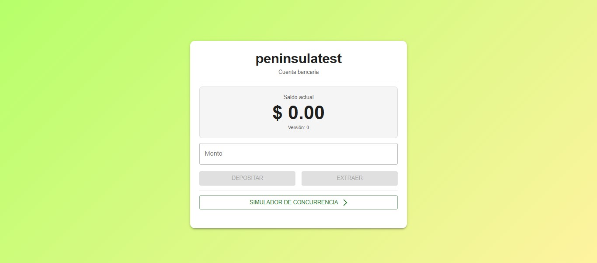

2) Depósito – ingreso de monto: El usuario ingresa el monto y el botón de depósito se activa.
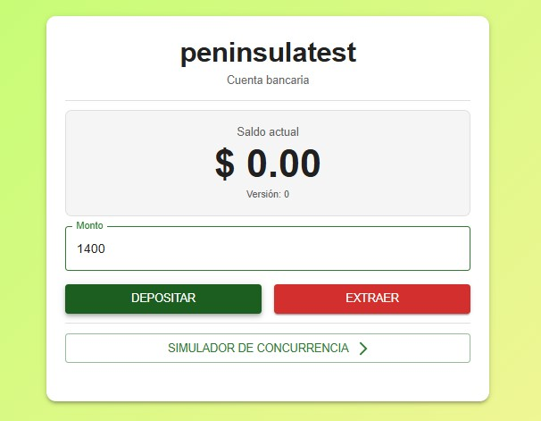

3) Depósito – saldo actualizado: Una vez realizado el depósito, se actualiza el saldo.
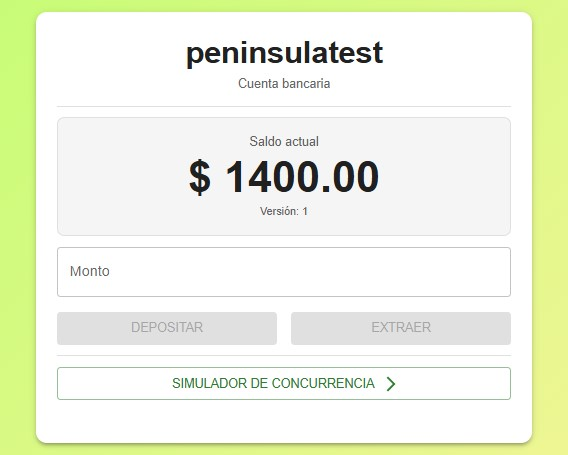

4) Extracción – ingreso de monto: El usuario ingresa el monto para extraer y el botón se activa.
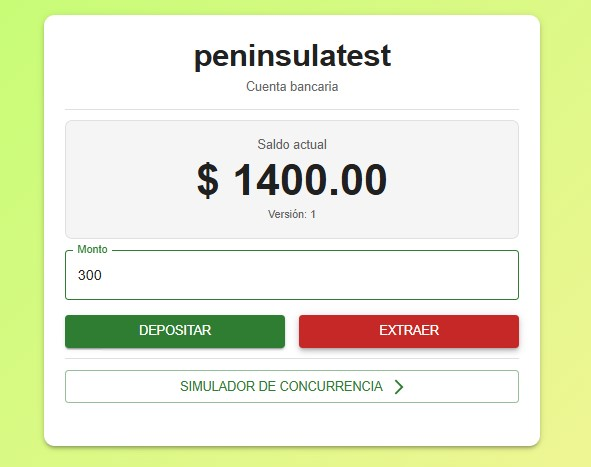

5) Extracción – saldo actualizado: Se refleja el nuevo saldo tras la extracción.
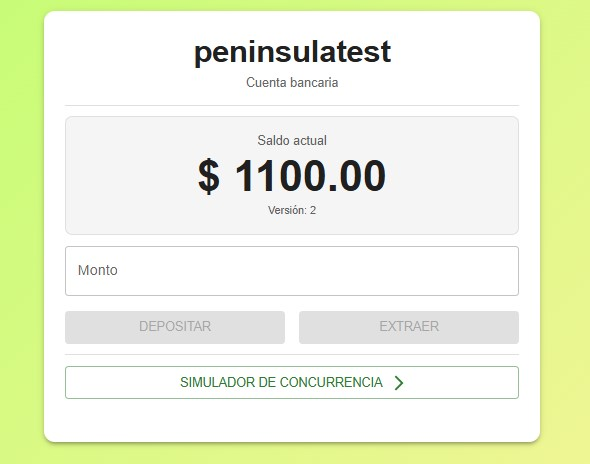

6) Simulación de concurrencia – panel abierto: Vista de la sección de simulación de concurrencia antes de ejecutar requests.
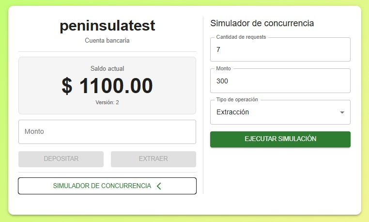

7) Primera simulación – resultados iniciales: Resultados de la primera ejecución de concurrencia.
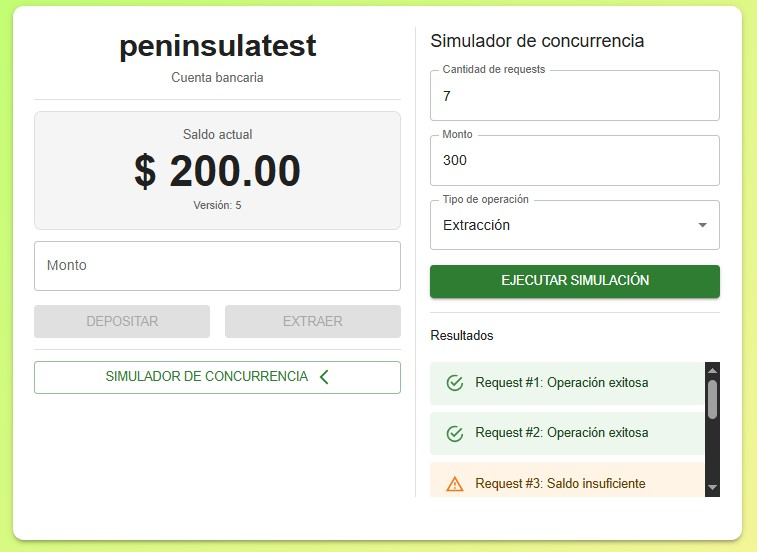

8) Primera simulación – resultados extras: Segunda parte de la respuesta de concurrencia del primer intento.
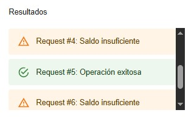

9) Segunda simulación – resultados iniciales: Resultados de la segunda ejecución de concurrencia.
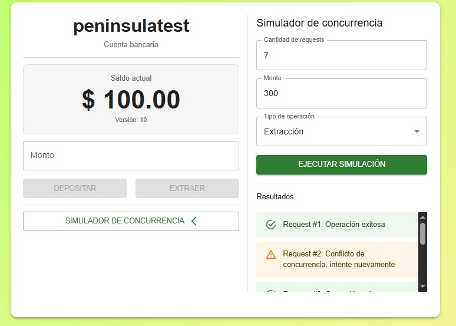

10) Segunda simulación – resultados extras: Segunda parte de la respuesta de concurrencia del segundo intento.
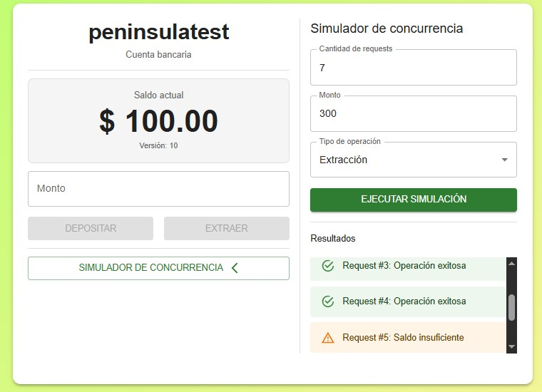

11) Error al levantar el frontend sin backend: Captura mostrando el error cuando el backend no está en ejecución.
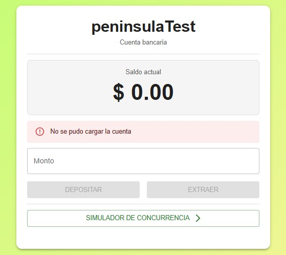